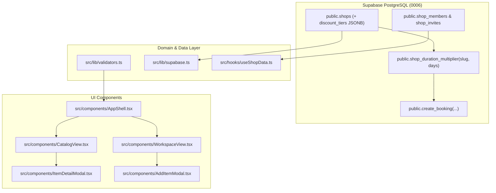

# Sebaraja Phase 1 (P0 Quick Wins & P1 Core Operations) Implementation Plan

> **For agentic workers:** REQUIRED SUB-SKILL: Use superpowers:subagent-driven-development to implement this plan task-by-task. Steps use checkbox (`- [ ]`) syntax for tracking.

**Goal:** Deliver Phase 1 (P0 Quick Wins + P1 Core Operations) improvements for Sebaraja: 1-day default duration with 1–60 day selector and Owner-controlled `discountTiers`, full Item Edit mode for Owners, Customer Item Detail modal, Terms/Google Maps/Discount Tiers editor in Shop Settings, 1-click WhatsApp customer follow-up in Bookings, Active Staff revocation, and unified `Sebaraja` + `Email Magic Link / OTP` branding.

**Architecture:** We extend the `shops` schema (`0006_phase1_improvements.sql`) with a `discount_tiers JSONB` column and a server-side `public.shop_duration_multiplier(p_shop_slug, p_duration_days)` function used by `create_booking` to prevent price tampering while giving shop owners full control over duration discounts (including 0% / no discount). On the client, pure functions in `src/lib/validators.ts` compute duration options, discounts, and WhatsApp follow-up templates, while modular React components (`ItemDetailModal.tsx`, `AddItemModal.tsx` edit mode, `CatalogView.tsx`, `WorkspaceView.tsx`, and `AppShell.tsx`) wire the end-to-end UX with Supabase + offline local fallback.

**Architecture Diagram:**



**Tech Stack:** Next.js 16.4.3 (App Router, Turbopack), React 19.3.0, TypeScript 5 (`strict: true`), Tailwind CSS v4, Supabase (`@supabase/supabase-js` v2), Zod v4, Node.js native test runner (`node --test`).

**Spec:** [2026-11-22-sebaraja-phase1-improvements-design.md](file:///e:/Project/sebaralat/docs/superpowers/specs/2026-11-22-sebaraja-phase1-improvements-design.md)

## Global Constraints

- Follow Next.js 16 & React 19 conventions (`AGENTS.md`); no synchronous `setState` inside `useEffect` bodies that causes cascading render warnings.
- Maintain 100% compatibility with both **Supabase Cloud Mode** and **Local State / Offline Demo Fallback Mode** (`!supabase`).
- Enforce role security: `customer` and `staff` must never mutate shop settings, item prices/identities, or member lists.
- All user-facing branding must use **Sebaraja** (replacing `SebarAlat`) and refer to **Email Magic Link / OTP** instead of PINs.
- All unit tests (`npm test`), linter (`npm run lint`), and production build (`npm run build`) must pass with 0 errors.

---

### Task 1: Database Migration 0006, Types, Supabase Mappers & Domain Validators

**Files:**
- Create: [supabase/migrations/0006_phase1_improvements.sql](file:///e:/Project/sebaralat/supabase/migrations/0006_phase1_improvements.sql)
- Modify: [supabase/schema.sql](file:///e:/Project/sebaralat/supabase/schema.sql)
- Modify: [src/types/index.ts](file:///e:/Project/sebaralat/src/types/index.ts)
- Modify: [src/lib/validators.ts](file:///e:/Project/sebaralat/src/lib/validators.ts)
- Modify: [src/lib/supabase.ts](file:///e:/Project/sebaralat/src/lib/supabase.ts)
- Modify: [src/data/mockData.ts](file:///e:/Project/sebaralat/src/data/mockData.ts)
- Test: [src/lib/__tests__/validators.test.ts](file:///e:/Project/sebaralat/src/lib/__tests__/validators.test.ts)

**Interfaces:**
- Produces:
  - `DiscountTier` (`{ minDays: number; discountPercent: number }`) in `src/types/index.ts`
  - `Shop.discountTiers?: DiscountTier[]` in `src/types/index.ts`
  - `DiscountTierSchema` in `src/lib/validators.ts`
  - `normalizeDiscountTiers(tiers?: DiscountTier[] | null): DiscountTier[]` in `src/lib/validators.ts`
  - `getAppliedDiscountPercent(durationDays: number, discountTiers?: DiscountTier[] | null): number` in `src/lib/validators.ts`
  - `getDurationMultiplier(durationDays: number, discountTiers?: DiscountTier[] | null): number` in `src/lib/validators.ts`
  - `buildShopDurationOptions(discountTiers?: DiscountTier[] | null, currentDays?: number): DurationOption[]` in `src/lib/validators.ts`
  - `buildGoogleMapsUrl(location: string, mapsUrl?: string | null): string` in `src/lib/validators.ts`
  - `buildBookingFollowUpWaMessage(booking: Booking, shopName: string): string` in `src/lib/validators.ts`

- [ ] **Step 1: Write failing tests in `src/lib/__tests__/validators.test.ts`**

Add tests for `normalizeDiscountTiers`, `getAppliedDiscountPercent`, `getDurationMultiplier` with custom Owner tiers and zero-discount tiers, `buildShopDurationOptions`, `buildGoogleMapsUrl`, and `buildBookingFollowUpWaMessage` to [src/lib/__tests__/validators.test.ts](file:///e:/Project/sebaralat/src/lib/__tests__/validators.test.ts):

```ts
  it('getDurationMultiplier mendukung tier diskon fleksibel milik Owner dan 0% (tanpa diskon)', () => {
    // Tanpa diskon (array kosong) -> murni jumlah hari
    assert.equal(getDurationMultiplier(3, []), 3);
    assert.equal(getDurationMultiplier(7, []), 7);

    // Tier kustom dari Owner: >= 3 hari diskon 10%, >= 7 hari diskon 25%, >= 14 hari diskon 40%
    const customTiers = [
      { minDays: 3, discountPercent: 10 },
      { minDays: 7, discountPercent: 25 },
      { minDays: 14, discountPercent: 40 },
    ];
    assert.equal(getDurationMultiplier(1, customTiers), 1);
    assert.equal(getDurationMultiplier(2, customTiers), 2);
    assert.equal(getDurationMultiplier(3, customTiers), 2.7);
    assert.equal(getDurationMultiplier(5, customTiers), 4.5); // 5 * 0.9
    assert.equal(getDurationMultiplier(7, customTiers), 5.25); // 7 * 0.75
    assert.equal(getDurationMultiplier(14, customTiers), 8.4); // 14 * 0.60
  });

  it('buildShopDurationOptions membentuk opsi paket populer + hari kustom sesuai tier diskon toko', () => {
    const tiers = [{ minDays: 5, discountPercent: 15 }];
    const opts = buildShopDurationOptions(tiers, 4);
    const daysList = opts.map((o) => o.days);
    // Wajib memuat paket dasar 1, 2, 3, 7 plus tier 5 dan durasi terpilih 4
    assert.ok(daysList.includes(1));
    assert.ok(daysList.includes(4));
    assert.ok(daysList.includes(5));
    const fiveDayOpt = opts.find((o) => o.days === 5)!;
    assert.equal(fiveDayOpt.discountTag, 'Hemat 15%');
    const threeDayOpt = opts.find((o) => o.days === 3)!;
    assert.equal(threeDayOpt.discountTag, null);
  });

  it('buildGoogleMapsUrl menggunakan mapsUrl kustom jika valid atau fallback ke query pencarian Maps', () => {
    assert.equal(
      buildGoogleMapsUrl('Balikpapan', 'https://maps.app.goo.gl/abc123'),
      'https://maps.app.goo.gl/abc123'
    );
    assert.equal(
      buildGoogleMapsUrl('Jl. MT Haryono, Balikpapan', ''),
      'https://www.google.com/maps/search/?api=1&query=Jl.%20MT%20Haryono%2C%20Balikpapan'
    );
  });

  it('buildBookingFollowUpWaMessage membuat pesan follow-up sesuai status booking', () => {
    const sampleBooking = {
      id: 'bk-1',
      shopSlug: 'borneo-rental',
      code: 'SBR-261122-ABCD',
      customerName: 'Budi Santoso',
      customerPhone: '628123456789',
      startDate: '2026-11-22',
      endDate: '2026-11-24',
      durationDays: 3,
      status: 'pending' as const,
      totalAmount: 150000,
      notes: '',
      createdAt: '2026-11-22T00:00:00Z',
    };
    const pendingMsg = buildBookingFollowUpWaMessage(sampleBooking, 'Borneo Rental');
    assert.ok(pendingMsg.includes('SBR-261122-ABCD'));
    assert.ok(pendingMsg.includes('Budi Santoso'));

    const pickedUpMsg = buildBookingFollowUpWaMessage(
      { ...sampleBooking, status: 'picked_up' },
      'Borneo Rental'
    );
    assert.ok(pickedUpMsg.includes('2026-11-24'));
  });
```

- [ ] **Step 2: Run test to verify it fails**

Run: `npm test`
Expected: FAIL because `buildShopDurationOptions`, `buildGoogleMapsUrl`, and `buildBookingFollowUpWaMessage` are not exported yet.

- [ ] **Step 3: Create `supabase/migrations/0006_phase1_improvements.sql` and update `supabase/schema.sql`**

Create [supabase/migrations/0006_phase1_improvements.sql](file:///e:/Project/sebaralat/supabase/migrations/0006_phase1_improvements.sql):

```sql
-- =========================================================
-- MIGRASI 0006: FASE 1 IMPROVEMENTS (TIER DISKON OWNER & VIEW SHOPS)
-- =========================================================

-- 1. Tambahkan kolom discount_tiers JSONB pada public.shops
-- Default: tier 3 hari (10%) & 7 hari (25%) yang dapat diubah atau dihapus (0%) oleh Owner
ALTER TABLE public.shops
ADD COLUMN IF NOT EXISTS discount_tiers JSONB NOT NULL DEFAULT '[{"minDays": 3, "discountPercent": 10}, {"minDays": 7, "discountPercent": 25}]'::jsonb;

COMMENT ON COLUMN public.shops.discount_tiers IS 'Daftar tier diskon durasi milik toko: [{"minDays": 3, "discountPercent": 10}]. Kosong [] berarti tanpa diskon durasi.';

-- Perbarui view publik shops_public agar menyertakan discount_tiers, pro_expires_at, billing_cycle
CREATE OR REPLACE VIEW public.shops_public AS
SELECT
  slug,
  name,
  tagline,
  category_type,
  location,
  maps_url,
  hours,
  whatsapp,
  is_verified,
  plan,
  pro_expires_at,
  billing_cycle,
  terms,
  discount_tiers,
  partner_shop,
  logo_url,
  created_at
FROM public.shops;

-- 2. Fungsi multiplier durasi berbasis konfigurasi discount_tiers milik toko
CREATE OR REPLACE FUNCTION public.shop_duration_multiplier(
  p_shop_slug TEXT,
  p_duration_days INTEGER
)
RETURNS NUMERIC
LANGUAGE plpgsql
STABLE
SECURITY DEFINER
SET search_path = ''
AS $$
DECLARE
  v_tiers JSONB;
  v_elem JSONB;
  v_min_days INTEGER;
  v_disc NUMERIC;
  v_best_min_days INTEGER := 0;
  v_best_discount NUMERIC := 0;
BEGIN
  IF p_duration_days IS NULL OR p_duration_days <= 1 THEN
    RETURN 1::numeric;
  END IF;

  SELECT discount_tiers INTO v_tiers
  FROM public.shops
  WHERE slug = p_shop_slug;

  IF v_tiers IS NULL OR jsonb_typeof(v_tiers) <> 'array' OR jsonb_array_length(v_tiers) = 0 THEN
    RETURN p_duration_days::numeric;
  END IF;

  FOR v_elem IN SELECT * FROM jsonb_array_elements(v_tiers)
  LOOP
    v_min_days := COALESCE((v_elem->>'minDays')::INTEGER, 0);
    v_disc := COALESCE((v_elem->>'discountPercent')::NUMERIC, 0);

    IF v_min_days >= 2
       AND v_min_days <= p_duration_days
       AND v_disc > 0
       AND v_disc <= 90
       AND v_min_days >= v_best_min_days THEN
      v_best_min_days := v_min_days;
      v_best_discount := v_disc;
    END IF;
  END LOOP;

  IF v_best_discount > 0 THEN
    RETURN round((p_duration_days * (1 - (v_best_discount / 100.0)))::numeric, 2);
  END IF;

  RETURN p_duration_days::numeric;
END;
$$;

-- 3. Perbarui RPC create_booking agar menggunakan public.shop_duration_multiplier(p_shop_slug, p_duration_days)
CREATE OR REPLACE FUNCTION public.create_booking(
  p_shop_slug TEXT,
  p_customer_name TEXT,
  p_customer_phone TEXT,
  p_start_date DATE,
  p_duration_days INTEGER,
  p_multiplier NUMERIC,
  p_lines JSONB,
  p_notes TEXT DEFAULT ''
)
RETURNS public.bookings
LANGUAGE plpgsql
SECURITY DEFINER
SET search_path = ''
AS $$
DECLARE
  v_end_date DATE;
  v_code TEXT;
  v_total NUMERIC := 0;
  v_booking public.bookings;
  v_line JSONB;
  v_item public.rental_items;
  v_qty INTEGER;
  v_avail INTEGER;
  v_effective_multiplier NUMERIC;
  v_subtotal NUMERIC;
BEGIN
  IF p_start_date < CURRENT_DATE THEN
    RAISE EXCEPTION 'Tanggal mulai sewa tidak boleh di masa lalu.';
  END IF;

  IF p_duration_days < 1 OR p_duration_days > 60 THEN
    RAISE EXCEPTION 'Durasi sewa harus antara 1 hingga 60 hari.';
  END IF;

  IF jsonb_typeof(p_lines) <> 'array' OR jsonb_array_length(p_lines) = 0 THEN
    RAISE EXCEPTION 'Keranjang sewa tidak boleh kosong.';
  END IF;

  v_end_date := p_start_date + (p_duration_days - 1);
  -- Gunakan aturan diskon durasi yang diatur oleh Owner toko di database
  v_effective_multiplier := public.shop_duration_multiplier(p_shop_slug, p_duration_days);

  v_code := 'SBR-' || to_char(CURRENT_DATE, 'YYMMDD') || '-' || upper(substr(replace(gen_random_uuid()::text, '-', ''), 1, 4));

  INSERT INTO public.bookings (
    shop_slug, code, customer_name, customer_phone, start_date, end_date, duration_days, status, total_amount, notes
  ) VALUES (
    p_shop_slug,
    v_code,
    trim(p_customer_name),
    regexp_replace(trim(p_customer_phone), '[^0-9+]', '', 'g'),
    p_start_date,
    v_end_date,
    p_duration_days,
    'pending',
    0,
    COALESCE(trim(p_notes), '')
  )
  RETURNING * INTO v_booking;

  FOR v_line IN SELECT * FROM jsonb_array_elements(p_lines)
  LOOP
    v_qty := (v_line->>'qty')::INTEGER;
    IF v_qty IS NULL OR v_qty <= 0 THEN
      RAISE EXCEPTION 'Jumlah unit harus lebih dari 0.';
    END IF;

    SELECT * INTO v_item
    FROM public.rental_items
    WHERE id = (v_line->>'item_id')::UUID
      AND shop_slug = p_shop_slug
    FOR UPDATE;

    IF NOT FOUND THEN
      RAISE EXCEPTION 'Unit tidak ditemukan pada katalog toko ini.';
    END IF;

    v_avail := public.available_item_qty(v_item.id, p_start_date, v_end_date);
    IF v_avail < v_qty THEN
      RAISE EXCEPTION 'Stok unit "%" tidak mencukupi untuk tanggal % s/d % (tersisa % unit).',
        v_item.name, p_start_date, v_end_date, v_avail;
    END IF;

    v_subtotal := round(v_item.price_per_day * v_effective_multiplier * v_qty);
    v_total := v_total + v_subtotal;

    INSERT INTO public.booking_lines (
      booking_id, item_id, item_name, qty, unit_price_per_day, subtotal
    ) VALUES (
      v_booking.id, v_item.id, v_item.name, v_qty, v_item.price_per_day, v_subtotal
    );
  END LOOP;

  UPDATE public.bookings
  SET total_amount = v_total
  WHERE id = v_booking.id
  RETURNING * INTO v_booking;

  INSERT INTO public.activity_logs (shop_slug, actor_id, actor_role, action)
  VALUES (
    p_shop_slug,
    auth.uid(),
    'Pelanggan',
    format('Pengajuan booking %s (%s) untuk %s s/d %s senilai Rp%s', v_code, trim(p_customer_name), p_start_date, v_end_date, v_total)
  );

  RETURN v_booking;
END;
$$;
```

Update [supabase/schema.sql](file:///e:/Project/sebaralat/supabase/schema.sql) to document migration `0006_phase1_improvements.sql`.

- [ ] **Step 4: Update `src/types/index.ts`, `src/lib/validators.ts`, `src/lib/supabase.ts`, and `src/data/mockData.ts`**

1. In [src/types/index.ts](file:///e:/Project/sebaralat/src/types/index.ts), add `DiscountTier` and `discountTiers?: DiscountTier[]` on `Shop`.
2. In [src/lib/validators.ts](file:///e:/Project/sebaralat/src/lib/validators.ts):
   - Add `DEFAULT_DISCOUNT_TIERS: DiscountTier[] = [{ minDays: 3, discountPercent: 10 }, { minDays: 7, discountPercent: 25 }]`.
   - Implement `normalizeDiscountTiers(tiers?: DiscountTier[] | null): DiscountTier[]`.
   - Implement `getAppliedDiscountPercent(durationDays: number, discountTiers?: DiscountTier[] | null): number`.
   - Update `getDurationMultiplier(durationDays: number, discountTiers?: DiscountTier[] | null): number` so that when `discountTiers` is omitted (`undefined`), it defaults to `DEFAULT_DISCOUNT_TIERS` (preserving existing tests), and when `discountTiers` is passed (including `[]`), it uses the shop's configured tiers.
   - Update `calculateCartSummary(cart, items, durationOption, availabilityMap, discountTiers)` to use `durationOption.multiplier` if provided or `getDurationMultiplier(durationOption.days, discountTiers)`.
   - Implement `buildShopDurationOptions(discountTiers?: DiscountTier[] | null, currentDays?: number): DurationOption[]`.
   - Implement `buildGoogleMapsUrl(location: string, mapsUrl?: string | null): string`.
   - Implement `buildBookingFollowUpWaMessage(booking: Booking, shopName: string): string`.
   - Add `DiscountTierSchema` and update `formatUpgradeWhatsappMessage` to use `Sebaraja` instead of `SebarAlat`.
3. In [src/lib/supabase.ts](file:///e:/Project/sebaralat/src/lib/supabase.ts), add `discount_tiers?: DiscountTier[] | null` to `ShopDbRow`, map it in `mapShopFromDb` and `mapShopToDb`.
4. In [src/data/mockData.ts](file:///e:/Project/sebaralat/src/data/mockData.ts), add `discountTiers` to `DEFAULT_SHOPS`.

- [ ] **Step 5: Run tests to verify Task 1 passes**

Run: `npm test`
Expected: PASS (all existing and new unit tests pass).

---

### Task 2: Hook `useShopData` — Active Team Members (`shop_members`), Staff Revocation & `discount_tiers` Sync

**Files:**
- Modify: [src/hooks/useShopData.ts](file:///e:/Project/sebaralat/src/hooks/useShopData.ts)

**Interfaces:**
- Consumes: `ShopMember`, `ShopMemberDbRow`, `mapMemberFromDb` from `src/lib/supabase.ts`
- Produces:
  - `members: ShopMember[]` returned from `useShopData`
  - `removeShopMember: (userId: string, email: string) => Promise<void>` returned from `useShopData`
  - `revokeShopInvite: (inviteId: string, email: string) => Promise<void>` returned from `useShopData`

- [ ] **Step 1: Add `members` state, `shop_members` fetching, `discount_tiers` selection, `removeShopMember`, and `revokeShopInvite` in `src/hooks/useShopData.ts`**

In [src/hooks/useShopData.ts](file:///e:/Project/sebaralat/src/hooks/useShopData.ts):
1. Include `discount_tiers` in the `shops` `.select(...)` query.
2. Add `const [members, setMembers] = useState<ShopMember[]>([]);`.
3. In `fetchWorkspaceData`, when `currentRole === 'owner'`, fetch `shop_members` for `activeShopSlug` (`shop_slug, user_id, email, role, created_at`) and map with `mapMemberFromDb`.
4. Implement `removeShopMember(userId: string, email: string)` (Owner-only: deletes from `shop_members` where `shop_slug = activeShopSlug` and `user_id = userId`, rolls back on error, records toast/audit log).
5. Implement `revokeShopInvite(inviteId: string, email: string)` (Owner-only: deletes from `shop_invites` where `id = inviteId` and `shop_slug = activeShopSlug`).
6. In `createBookingOrder`, compute `safeMultiplier = getDurationMultiplier(durationDays, shop?.discountTiers)`.

- [ ] **Step 2: Run tests & typecheck**

Run: `npm test`
Expected: PASS.

---

### Task 3: Item Detail Modal (`ItemDetailModal.tsx`) & Edit Mode in `AddItemModal.tsx`

**Files:**
- Create: [src/components/ItemDetailModal.tsx](file:///e:/Project/sebaralat/src/components/ItemDetailModal.tsx)
- Modify: [src/components/AddItemModal.tsx](file:///e:/Project/sebaralat/src/components/AddItemModal.tsx)

**Interfaces:**
- Produces:
  - `ItemDetailModal` component in `src/components/ItemDetailModal.tsx`
  - `AddItemModal` with optional `editingItem?: RentalItem | null` and `spec3?: string` support in `src/components/AddItemModal.tsx`

- [ ] **Step 1: Create `src/components/ItemDetailModal.tsx`**

Create [src/components/ItemDetailModal.tsx](file:///e:/Project/sebaralat/src/components/ItemDetailModal.tsx) to display full product photos, all specification bullets without truncation, SKU/category badges, availability count for the selected dates, per-day vs duration pricing, and direct cart `+/-` or WhatsApp booking inquiry buttons.

- [ ] **Step 2: Add Edit Unit Mode & 3rd Specification Field to `src/components/AddItemModal.tsx`**

Update [src/components/AddItemModal.tsx](file:///e:/Project/sebaralat/src/components/AddItemModal.tsx):
1. Add optional `spec3?: string` to `NewItemFormState` and optional `editingItem?: RentalItem | null` to `AddItemModalProps`.
2. Bypass `if (isLimitReached)` when `Boolean(editingItem)` is true (editing an existing unit does not increase item count).
3. Update modal header to `"Edit Unit Inventaris"` and submit button to `"Simpan Perubahan Unit"` when `editingItem` is present.
4. Provide inputs for `spec1`, `spec2`, and `spec3` so all 3 specification points of existing items can be edited cleanly.

---

### Task 4: Catalog UX Upgrade (`CatalogView.tsx`) & Branding/Copywriting Alignment (`LandingPage.tsx`, `UpgradeModal.tsx`)

**Files:**
- Modify: [src/components/CatalogView.tsx](file:///e:/Project/sebaralat/src/components/CatalogView.tsx)
- Modify: [src/components/LandingPage.tsx](file:///e:/Project/sebaralat/src/components/LandingPage.tsx)
- Modify: [src/components/UpgradeModal.tsx](file:///e:/Project/sebaralat/src/components/UpgradeModal.tsx)

**Interfaces:**
- Consumes: `buildGoogleMapsUrl` from `src/lib/validators.ts`
- Produces:
  - Updated `CatalogViewProps` with `endDate?: string` and `onSelectItemDetail?: (item: RentalItem) => void`

- [ ] **Step 1: Upgrade `src/components/CatalogView.tsx`**

In [src/components/CatalogView.tsx](file:///e:/Project/sebaralat/src/components/CatalogView.tsx):
1. Turn the shop location in the header into a clickable Google Maps link (`buildGoogleMapsUrl(shop.location, shop.mapsUrl)`) with an external link indicator and `"Lihat Peta"`.
2. Upgrade the sticky duration selector to support:
   - Quick preset select (`durationOptions`) AND a custom day stepper/input (`1` to `60` days) with the computed return date (`endDate`) clearly displayed.
   - Dynamic discount badge (`Promo {currentDurationObj.discountTag}`) shown only when the shop's Owner has configured a discount for the selected duration.
3. Make the item thumbnail and item title clickable (`onSelectItemDetail?.(item)`) with a `"Lihat Detail"` hint so customers can view full photos and complete specifications.
4. Replace `"Powered by SebarAlat"` and `"gratis dari SebarAlat"` with `"Powered by Sebaraja"` and `"gratis dari Sebaraja"`.

- [ ] **Step 2: Standardize Branding & Auth Copywriting in `src/components/LandingPage.tsx` and `src/components/UpgradeModal.tsx`**

1. In [src/components/LandingPage.tsx](file:///e:/Project/sebaralat/src/components/LandingPage.tsx):
   - Replace `"sistem PIN khusus untuk staf gudang Anda"` with `"akses login khusus untuk staf gudang Anda"`.
   - Replace `"2. Role Staf Gudang (PIN Khusus)"` with `"2. Role Staf Gudang (Akses Terbatas)"`.
   - Replace `"Akses Multi-Role: PIN Staf Gudang & PIN Owner terpisah"` with `"Akses Multi-Role: Login Email Magic Link / OTP untuk Staf Gudang & Owner"`.
2. In [src/components/UpgradeModal.tsx](file:///e:/Project/sebaralat/src/components/UpgradeModal.tsx):
   - Replace `"AJUKAN UPGRADE KE ADMIN SEBARALAT"` with `"AJUKAN UPGRADE KE ADMIN SEBARAJA"`.

---

### Task 5: Workspace Operational Upgrade (`WorkspaceView.tsx`) & App Orchestrator (`AppShell.tsx`)

**Files:**
- Modify: [src/components/WorkspaceView.tsx](file:///e:/Project/sebaralat/src/components/WorkspaceView.tsx)
- Modify: [src/components/AppShell.tsx](file:///e:/Project/sebaralat/src/components/AppShell.tsx)

**Interfaces:**
- Consumes:
  - `buildBookingFollowUpWaMessage`, `normalizeDiscountTiers`, `buildShopDurationOptions` from `src/lib/validators.ts`
  - `ItemDetailModal` from `src/components/ItemDetailModal.tsx`
  - `members`, `removeShopMember`, `revokeShopInvite` from `src/hooks/useShopData.ts`

- [ ] **Step 1: Upgrade `src/components/WorkspaceView.tsx`**

In [src/components/WorkspaceView.tsx](file:///e:/Project/sebaralat/src/components/WorkspaceView.tsx):
1. **Tab Stok (Inventory)**:
   - Add an **Edit Unit** button (`Pencil` icon) next to QR and Delete buttons on each unit card for `currentRole === 'owner'`, calling `onOpenEditModal(item)`.
2. **Tab Booking**:
   - Add a **Chat WA Penyewa** button on every booking card that opens WhatsApp to `bk.customerPhone` pre-filled with `buildBookingFollowUpWaMessage(bk, shop.name)`.
3. **Tab Profil (Settings - Owner Only)**:
   - Add **Link Google Maps (`mapsUrl`)** input field.
   - Add **Syarat & Ketentuan Sewa (`terms`)** editor (dynamic list of points + add/remove point buttons).
   - Add **Pengaturan Diskon Durasi Sewa (`discountTiers`)** editor where Owner can edit `%` discount for duration tiers (e.g. `≥ 3 Hari`, `≥ 7 Hari`), add custom day tiers (`2`–`60` days, `0%`–`90%`), or set to `0%` / remove all tiers so no automatic discount is applied.
   - Add **Daftar Anggota Tim Aktif (`members`)** with a **"Cabut Akses"** button for staff members (`onRemoveMember(m.userId, m.email)`) and a **"Batalkan"** button for pending invites (`onRevokeInvite(inv.id, inv.email)`).

- [ ] **Step 2: Wire Everything Together in `src/components/AppShell.tsx`**

In [src/components/AppShell.tsx](file:///e:/Project/sebaralat/src/components/AppShell.tsx):
1. Change initial `durationDays` state from `2` to `1`.
2. Compute `durationOptions` dynamically via `buildShopDurationOptions(shop?.discountTiers, durationDays)` and `currentDurationObj` using the shop's `discountTiers`.
3. Pass `shop?.discountTiers` to `calculateCartSummary`.
4. Add `editingItem` state (`RentalItem | null`) and `detailItem` state (`RentalItem | null`).
5. Implement `handleOpenEditItem(item: RentalItem)` and update `handleSaveItem(formData: NewItemFormState)` to support both creating a new item and updating an existing `editingItem`.
6. Render `<ItemDetailModal />` when `detailItem` is selected in the catalog.

- [ ] **Step 3: Run Full Verification (`npm test`, `npm run lint`, `npm run build`)**

Run: `npm test && npm run lint && npm run build`
Expected: All tests pass, 0 lint warnings/errors, production Next.js build succeeds.
