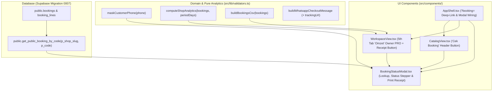

# Sebaraja Phase 2 (P2 PRO Monetization) Implementation Plan

> **For agentic workers:** REQUIRED SUB-SKILL: Use superpowers:subagent-driven-development to implement this plan task-by-task. Steps use checkbox (`- [ ]`) syntax for tracking.

**Goal:** Implement Phase 2 (P2 PRO Monetization) features for Sebaraja: a public booking status lookup & printable receipt modal (`BookingStatusModal.tsx`) powered by a PII-masking Supabase RPC (`get_public_booking_by_code`) and deep-link (`/[slug]?booking=SBR-XXXX`), plus a 5th Workspace tab (`Omzet` / `analytics`) exclusively for Owner PRO accounts featuring Revenue KPIs, Top Performing Rental Units, and 1-click CSV export.

**Architecture:** We add migration `0007_phase2_pro_monetization.sql` defining `public.get_public_booking_by_code(p_shop_slug, p_booking_code)` with `SECURITY DEFINER` and server-side phone masking so anonymous customers can track their exact booking code without exposing the `bookings` table to public enumeration. In `src/lib/validators.ts`, we add pure functions (`maskCustomerPhone`, `computeShopAnalytics`, `buildBookingsCsv`, and `trackingUrl` support in `buildWhatsappCheckoutMessage`). On the UI layer, `BookingStatusModal.tsx` serves both customer lookup/receipt printing and admin receipt printing, while `WorkspaceView.tsx` gains the 5th `Omzet` tab with PRO gating.

**Architecture Diagram:**



**Tech Stack:** Next.js 16.4.3 (App Router, Turbopack), React 19.3.0, TypeScript 5 (`strict: true`), Tailwind CSS v4, Supabase (`@supabase/supabase-js` v2), Zod v4, Node.js test runner (`node --test`).

**Spec:** [2026-11-22-sebaraja-phase2-pro-monetization-design.md](file:///e:/Project/sebaralat/docs/superpowers/specs/2026-11-22-sebaraja-phase2-pro-monetization-design.md)

## Global Constraints

- Protect customer PII: public booking lookups must always mask middle digits of `customerPhone` (`62812****890`).
- Maintain full offline/demo fallback compatibility (`!supabase` and demo showcase shops `borneo-rental` / `kaltim-kamera`).
- Restrict the 5th Workspace tab (`Omzet` / `analytics`) strictly to `currentRole === 'owner'`, and show a PRO upgrade paywall when `!isPro`.
- Ensure all unit tests (`npm test`), linter (`npm run lint`), and production build (`npm run build`) pass with 0 errors.

---

### Task 1: Database Migration 0007, Types & Pure Analytics / CSV / PII Masking Utilities

**Files:**
- Create: [supabase/migrations/0007_phase2_pro_monetization.sql](file:///e:/Project/sebaralat/supabase/migrations/0007_phase2_pro_monetization.sql)
- Modify: [supabase/schema.sql](file:///e:/Project/sebaralat/supabase/schema.sql)
- Modify: [src/types/index.ts](file:///e:/Project/sebaralat/src/types/index.ts)
- Modify: [src/lib/validators.ts](file:///e:/Project/sebaralat/src/lib/validators.ts)
- Test: [src/lib/__tests__/validators.test.ts](file:///e:/Project/sebaralat/src/lib/__tests__/validators.test.ts)

**Interfaces:**
- Produces:
  - `WorkspaceTab = 'inventory' | 'bookings' | 'analytics' | 'logs' | 'settings'` in `src/types/index.ts`
  - `TopItemAnalytics`, `ShopAnalyticsSummary` in `src/types/index.ts`
  - `maskCustomerPhone(phone: string): string` in `src/lib/validators.ts`
  - `computeShopAnalytics(bookings: Booking[], periodDays?: number | null, nowMs?: number): ShopAnalyticsSummary` in `src/lib/validators.ts`
  - `buildBookingsCsv(bookings: Booking[]): string` in `src/lib/validators.ts`
  - `trackingUrl?: string` parameter in `buildWhatsappCheckoutMessage` in `src/lib/validators.ts`

- [ ] **Step 1: Write failing unit tests in `src/lib/__tests__/validators.test.ts`**

Add tests for `maskCustomerPhone`, `computeShopAnalytics`, `buildBookingsCsv`, and `trackingUrl` in `buildWhatsappCheckoutMessage` to [src/lib/__tests__/validators.test.ts](file:///e:/Project/sebaralat/src/lib/__tests__/validators.test.ts):

```ts
  it('maskCustomerPhone menyamarkan digit tengah nomor telepon penyewa untuk tampilan publik', () => {
    assert.equal(maskCustomerPhone('6281234567890'), '62812****890');
    assert.equal(maskCustomerPhone('0812998877'), '0812****77');
  });

  it('computeShopAnalytics menghitung omzet terealisasi, pending, konversi, AOV, dan top items dengan akurat', () => {
    const nowMs = Date.parse('2026-11-22T12:00:00Z');
    const sampleBookings = [
      {
        id: 'b1',
        shopSlug: 'borneo-rental',
        code: 'SBR-261120-AA11',
        customerName: 'Andi',
        customerPhone: '628111222333',
        startDate: '2026-11-20',
        endDate: '2026-11-21',
        durationDays: 2,
        status: 'returned' as const,
        totalAmount: 200000,
        notes: '',
        createdAt: '2026-11-20T08:00:00Z',
        lines: [
          {
            id: 'l1',
            bookingId: 'b1',
            itemId: 'i1',
            itemName: 'Tenda Eiger 4P',
            qty: 2,
            unitPricePerDay: 50000,
            subtotal: 200000,
          },
        ],
      },
      {
        id: 'b2',
        shopSlug: 'borneo-rental',
        code: 'SBR-261121-BB22',
        customerName: 'Budi',
        customerPhone: '628111222444',
        startDate: '2026-11-21',
        endDate: '2026-11-22',
        durationDays: 2,
        status: 'confirmed' as const,
        totalAmount: 350000,
        notes: '',
        createdAt: '2026-11-21T08:00:00Z',
        lines: [
          {
            id: 'l2',
            bookingId: 'b2',
            itemId: 'i2',
            itemName: 'Genset Silent 2200W',
            qty: 1,
            unitPricePerDay: 175000,
            subtotal: 350000,
          },
        ],
      },
      {
        id: 'b3',
        shopSlug: 'borneo-rental',
        code: 'SBR-261122-CC33',
        customerName: 'Citra',
        customerPhone: '628111222555',
        startDate: '2026-11-22',
        endDate: '2026-11-22',
        durationDays: 1,
        status: 'pending' as const,
        totalAmount: 120000,
        notes: '',
        createdAt: '2026-11-22T08:00:00Z',
        lines: [],
      },
    ];

    const summary = computeShopAnalytics(sampleBookings, null, nowMs);
    assert.equal(summary.realizedRevenue, 550000);
    assert.equal(summary.pendingRevenue, 120000);
    assert.equal(summary.totalBookings, 3);
    assert.equal(summary.activeOrCompletedCount, 2);
    assert.equal(summary.averageOrderValue, 275000);
    assert.equal(summary.topItems.length, 2);
    assert.equal(summary.topItems[0].itemName, 'Genset Silent 2200W');
    assert.equal(summary.topItems[0].totalRevenue, 350000);
  });

  it('buildBookingsCsv menghasilkan format CSV valid dengan header dan baris data', () => {
    const csv = buildBookingsCsv([
      {
        id: 'b1',
        shopSlug: 'borneo-rental',
        code: 'SBR-261120-AA11',
        customerName: 'Andi "Proyek"',
        customerPhone: '628111222333',
        startDate: '2026-11-20',
        endDate: '2026-11-21',
        durationDays: 2,
        status: 'confirmed',
        totalAmount: 200000,
        notes: 'Catatan, penting',
        createdAt: '2026-11-20T08:00:00Z',
      },
    ]);
    assert.ok(csv.includes('Kode Booking,Tanggal Buat,Nama Penyewa'));
    assert.ok(csv.includes('SBR-261120-AA11'));
    assert.ok(csv.includes('"Andi ""Proyek"""'));
  });
```

- [ ] **Step 2: Create `supabase/migrations/0007_phase2_pro_monetization.sql` and update `supabase/schema.sql`**

Create [supabase/migrations/0007_phase2_pro_monetization.sql](file:///e:/Project/sebaralat/supabase/migrations/0007_phase2_pro_monetization.sql):

```sql
-- =========================================================
-- MIGRASI 0007: FASE 2 MONETISASI PRO (RPC CEK BOOKING PUBLIK AMAN)
-- =========================================================

-- RPC Pencarian Kode Booking Publik (Tanpa Membuka RLS SELECT Tabel Bookings ke Anon)
-- Menyamarkan nomor telepon penyewa untuk menjaga privasi PII pelanggan
CREATE OR REPLACE FUNCTION public.get_public_booking_by_code(
  p_shop_slug TEXT,
  p_booking_code TEXT
)
RETURNS JSONB
LANGUAGE plpgsql
STABLE
SECURITY DEFINER
SET search_path = ''
AS $$
DECLARE
  v_booking public.bookings;
  v_masked_phone TEXT;
  v_len INT;
  v_lines JSONB;
BEGIN
  IF p_shop_slug IS NULL OR p_booking_code IS NULL OR char_length(trim(p_booking_code)) < 4 THEN
    RETURN NULL;
  END IF;

  SELECT * INTO v_booking
  FROM public.bookings
  WHERE shop_slug = trim(p_shop_slug)
    AND lower(code) = lower(trim(p_booking_code))
  LIMIT 1;

  IF NOT FOUND THEN
    RETURN NULL;
  END IF;

  v_len := char_length(v_booking.customer_phone);
  IF v_len > 7 THEN
    v_masked_phone := substr(v_booking.customer_phone, 1, 5) || '****' || substr(v_booking.customer_phone, v_len - 2, 3);
  ELSIF v_len > 4 THEN
    v_masked_phone := substr(v_booking.customer_phone, 1, 2) || '****' || substr(v_booking.customer_phone, v_len - 1, 2);
  ELSE
    v_masked_phone := '****';
  END IF;

  SELECT COALESCE(
    jsonb_agg(
      jsonb_build_object(
        'id', bl.id,
        'booking_id', bl.booking_id,
        'item_id', bl.item_id,
        'item_name', bl.item_name,
        'qty', bl.qty,
        'unit_price_per_day', bl.unit_price_per_day,
        'subtotal', bl.subtotal
      )
    ),
    '[]'::jsonb
  ) INTO v_lines
  FROM public.booking_lines bl
  WHERE bl.booking_id = v_booking.id;

  RETURN jsonb_build_object(
    'id', v_booking.id,
    'shop_slug', v_booking.shop_slug,
    'code', v_booking.code,
    'customer_name', v_booking.customer_name,
    'customer_phone', v_masked_phone,
    'start_date', v_booking.start_date,
    'end_date', v_booking.end_date,
    'duration_days', v_booking.duration_days,
    'status', v_booking.status,
    'total_amount', v_booking.total_amount,
    'notes', v_booking.notes,
    'created_at', v_booking.created_at,
    'booking_lines', v_lines
  );
END;
$$;
```

- [ ] **Step 3: Implement types in `src/types/index.ts` and utilities in `src/lib/validators.ts`**

1. In [src/types/index.ts](file:///e:/Project/sebaralat/src/types/index.ts):
   - Update `export type WorkspaceTab = 'inventory' | 'bookings' | 'analytics' | 'logs' | 'settings';`.
   - Add `TopItemAnalytics` and `ShopAnalyticsSummary` interfaces.
2. In [src/lib/validators.ts](file:///e:/Project/sebaralat/src/lib/validators.ts):
   - Implement `maskCustomerPhone(phone: string): string`.
   - Implement `computeShopAnalytics(bookings: Booking[], periodDays?: number | null, nowMs?: number): ShopAnalyticsSummary`.
   - Implement `buildBookingsCsv(bookings: Booking[]): string`.
   - Update `buildWhatsappCheckoutMessage` to accept optional `trackingUrl?: string` and append `🔗 *Cek Status & Nota Booking:* ${trackingUrl}\n` when provided.

---

### Task 2: Hook `useShopData` — Demo Bookings Seed & `lookupPublicBookingByCode`

**Files:**
- Modify: [src/data/mockData.ts](file:///e:/Project/sebaralat/src/data/mockData.ts)
- Modify: [src/hooks/useShopData.ts](file:///e:/Project/sebaralat/src/hooks/useShopData.ts)

**Interfaces:**
- Produces:
  - `DEFAULT_BOOKINGS: Booking[]` in `src/data/mockData.ts`
  - `lookupBookingByCode: (code: string) => Promise<Booking | null>` in `src/hooks/useShopData.ts`

- [ ] **Step 1: Add `DEFAULT_BOOKINGS` in `src/data/mockData.ts` and `lookupBookingByCode` in `src/hooks/useShopData.ts`**

1. In [src/data/mockData.ts](file:///e:/Project/sebaralat/src/data/mockData.ts), export `DEFAULT_BOOKINGS` with realistic sample bookings for `borneo-rental` and `kaltim-kamera` (codes `SBR-261120-BR01`, `SBR-261121-BR02`, `SBR-261122-KK01`) so the `Omzet` tab and `Cek Booking` lookup work out-of-the-box in demo mode.
2. In [src/hooks/useShopData.ts](file:///e:/Project/sebaralat/src/hooks/useShopData.ts):
   - Initialize `bookings` state with `DEFAULT_BOOKINGS`.
   - Add `lookupBookingByCode(code: string): Promise<Booking | null>` that checks local `bookings` first (masking phone if `currentRole === 'customer'`), and if `supabase` is configured, calls `supabase.rpc('get_public_booking_by_code', { p_shop_slug: activeShopSlug, p_booking_code: cleanCode })`.

---

### Task 3: Booking Status Lookup & Printable Receipt Modal (`BookingStatusModal.tsx`)

**Files:**
- Create: [src/components/BookingStatusModal.tsx](file:///e:/Project/sebaralat/src/components/BookingStatusModal.tsx)

**Interfaces:**
- Produces: `BookingStatusModal` component supporting both customer code lookup (`SBR-YYMMDD-XXXX`) and direct receipt viewing/printing (`window.print()`).

- [ ] **Step 1: Create `src/components/BookingStatusModal.tsx`**

Create [src/components/BookingStatusModal.tsx](file:///e:/Project/sebaralat/src/components/BookingStatusModal.tsx) with:
- Search bar for booking code (`SBR-...`) + quick demo code chips when on demo shops (`borneo-rental` / `kaltim-kamera`).
- 4-stage visual status timeline (`Pending` -> `Confirmed` -> `Picked Up` -> `Returned`, or `Cancelled`).
- Official Shop Receipt card (Shop Name, Location, Booking Code, Customer Name, Phone, Rental Period, Itemized table with subtotals, and Total Cost).
- Action buttons: **Cetak / Simpan Nota (PDF)**, **Salin Link Tiket**, and **Tanya Admin via WA**.

---

### Task 4: 5th Workspace Tab `Omzet` (`WorkspaceView.tsx`), Catalog Header Lookup (`CatalogView.tsx`) & Deep-Link Orchestration (`AppShell.tsx`)

**Files:**
- Modify: [src/components/CatalogView.tsx](file:///e:/Project/sebaralat/src/components/CatalogView.tsx)
- Modify: [src/components/WorkspaceView.tsx](file:///e:/Project/sebaralat/src/components/WorkspaceView.tsx)
- Modify: [src/components/AppShell.tsx](file:///e:/Project/sebaralat/src/components/AppShell.tsx)

- [ ] **Step 1: Add `"Cek Booking"` button in `src/components/CatalogView.tsx` header**

In [src/components/CatalogView.tsx](file:///e:/Project/sebaralat/src/components/CatalogView.tsx), add `onOpenBookingLookup?: () => void` prop and render a `"Cek Booking"` button in the shop header next to the theme toggle and share button.

- [ ] **Step 2: Add 5th Tab `Omzet` (`analytics`) and Booking Receipt button in `src/components/WorkspaceView.tsx`**

In [src/components/WorkspaceView.tsx](file:///e:/Project/sebaralat/src/components/WorkspaceView.tsx):
1. Change sub-navigation grid from `grid-cols-4` to `grid-cols-5` and add the **Omzet** tab button (`TrendingUp` icon, restricted to `currentRole === 'owner'`).
2. In the **Booking** tab, add a **"Cetak Nota"** button (`Printer` icon) on each booking card calling `onOpenBookingReceipt?.(bk)`.
3. Render the **Omzet (`workspaceTab === 'analytics'`)** view:
   - If `!isPro`, render the **Bisnis PRO** upgrade paywall card.
   - If `isPro`, render period filter pills (`Semua Waktu`, `30 Hari`, `7 Hari`), **"Unduh CSV"** button, 4 KPI Bento cards (`Omzet Terealisasi`, `Menunggu DP`, `Tingkat Konversi`, `Rata-rata Sewa / AOV`), and **Peringkat Alat Paling Laris (Top Performing Units)**.

- [ ] **Step 3: Wire `?booking=SBR-...` deep-link and `BookingStatusModal` in `src/components/AppShell.tsx`**

In [src/components/AppShell.tsx](file:///e:/Project/sebaralat/src/components/AppShell.tsx):
1. Detect `?booking=` query param on mount to automatically open `BookingStatusModal` with that code.
2. Include `trackingUrl` (`${origin}/${shop.slug}?booking=${booking.code}`) in `buildWhatsappCheckoutMessage` when creating a booking.
3. Render `<BookingStatusModal />` and connect `onOpenBookingLookup` in `CatalogView` and `onOpenBookingReceipt` in `WorkspaceView`.

- [ ] **Step 4: Run Full Verification (`npm test`, `npm run lint`, `npm run build`)**

Run: `npm test; if ($LASTEXITCODE -eq 0) { npm run lint }; if ($LASTEXITCODE -eq 0) { npm run build }`
Expected: All tests pass, 0 lint errors, production build succeeds.
