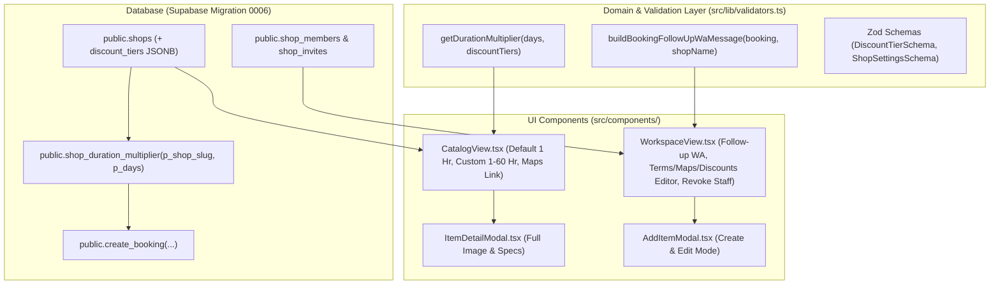

# Spesifikasi Desain: Sebaraja Fase 1 (P0 Quick Wins & P1 Operasional Inti)

**Tanggal:** 2026-11-22  
**Status:** Menunggu Persetujuan Akhir Spesifikasi  
**Lingkup:** Fase 1 (P0 Quick Wins + P1 Operasional Inti)

---

## 1. Tujuan & Latar Belakang

Meningkatkan pengalaman **Pelaku Usaha Rental (Owner & Staf Gudang)** dan **Pelanggan Penyewa** di platform **Sebaraja** dengan menyelesaikan celah fungsional operasional harian (P0) serta friksi konversi penyewa (P1):

1. **Durasi Default 1 Hari & Pemilih Durasi 1–60 Hari + Tier Diskon Fleksibel milik Owner**:
   - Mengubah durasi default katalog dari `2 Hari` menjadi `1 Hari` agar harga di kartu produk langsung mencerminkan tarif harian dasar.
   - Menyediakan pilihan paket populer (`1 Hari`, `2 Hari`, `3 Hari`, `7 Hari`) ditambah mode **Custom Hari (1–60 Hari / Pilih Tanggal Kembali)**.
   - Menghapus diskon otomatis yang di-hardcode; menggantinya dengan **Tier Diskon Durasi per Toko (`discountTiers`)** yang sepenuhnya diatur oleh Owner di Pengaturan Toko (dapat diset `0%` jika tanpa diskon, atau ditambah tier kustom).
2. **Modal Edit Unit & Modal Detail Alat (Pelanggan)**:
   - Owner dapat mengedit unit inventaris yang sudah ada (Nama, SKU, Kategori, Tarif/Hari, Stok, Spesifikasi, Foto) melalui mode edit pada [AddItemModal.tsx](file:///e:/Project/sebaralat/src/components/AddItemModal.tsx).
   - Pelanggan dapat mengeklik kartu/foto unit di [CatalogView.tsx](file:///e:/Project/sebaralat/src/components/CatalogView.tsx) untuk membuka `ItemDetailModal.tsx` yang menampilkan foto ukuran penuh, daftar spesifikasi lengkap tanpa terpotong (`truncate`), status stok pada tanggal terpilih, dan tombol tambah ke keranjang.
3. **Editor Syarat & Ketentuan (`terms`), Link Google Maps (`mapsUrl`), & Lokasi Klik-Langsung**:
   - Owner dapat mengedit daftar poin Syarat & Ketentuan sewa (`terms`) serta tautan Google Maps (`mapsUrl`) di tab Profil [WorkspaceView.tsx](file:///e:/Project/sebaralat/src/components/WorkspaceView.tsx).
   - Di [CatalogView.tsx](file:///e:/Project/sebaralat/src/components/CatalogView.tsx), alamat lokasi toko menjadi tautan aktif yang membuka `mapsUrl` (atau pencarian Google Maps otomatis jika `mapsUrl` kosong).
4. **Follow-up WhatsApp Penyewa 1-Klik & Manajemen Cabut Akses Staf**:
   - Di tab Booking [WorkspaceView.tsx](file:///e:/Project/sebaralat/src/components/WorkspaceView.tsx), setiap kartu pesanan memiliki tombol **Chat WA Penyewa** (dengan template pesan konfirmasi DP / pengingat pengembalian sesuai status booking).
   - Di tab Profil [WorkspaceView.tsx](file:///e:/Project/sebaralat/src/components/WorkspaceView.tsx), Owner dapat melihat daftar anggota aktif (`shop_members`) dan mencabut akses (`Revoke / Hapus`) Staf Gudang, serta mencabut undangan (`shop_invites`) yang masih tertunda.
5. **Konsistensi Branding `Sebaraja` & Copywriting Login `Email Magic Link / OTP`**:
   - Menyeragamkan seluruh penyebutan nama platform menjadi **Sebaraja** (menggantikan sisa teks `SebarAlat` di [CatalogView.tsx](file:///e:/Project/sebaralat/src/components/CatalogView.tsx), [UpgradeModal.tsx](file:///e:/Project/sebaralat/src/components/UpgradeModal.tsx), dan [validators.ts](file:///e:/Project/sebaralat/src/lib/validators.ts)).
   - Menyelaraskan copywriting autentikasi di [LandingPage.tsx](file:///e:/Project/sebaralat/src/components/LandingPage.tsx) dari *"PIN Khusus"* menjadi *"Akses Email Magic Link / OTP (Tanpa Password)"* sesuai arsitektur Supabase Auth yang berjalan.

---

## 2. Evaluasi Pendekatan Teknis

| Pendekatan | Deskripsi | Kelebihan | Kekurangan | Keputusan |
| :--- | :--- | :--- | :--- | :--- |
| **A. JSONB `discount_tiers` pada `shops` + Modular UI Modals (Recommended)** | Menyimpan aturan diskon durasi sebagai kolom `discount_tiers JSONB` di tabel `shops` (mirip kolom `terms JSONB`), memperbarui fungsi SQL `shop_duration_multiplier(p_shop_slug, p_duration_days)` di migrasi `0006`, serta memperluas komponen modal yang ada. | Skema ringkas, tidak perlu JOIN tambahan saat load katalog, perhitungan harga tetap tervalidasi aman di server (anti price-tampering) maupun klien. | Membutuhkan validasi struktur JSONB via Zod & constraint SQL. | **Dipilih** |
| **B. Tabel Relasional `shop_discount_tiers` Terpisah** | Membuat tabel baru `shop_discount_tiers(id, shop_slug, min_days, discount_percent)` dengan RLS tersendiri. | Normalisasi penuh di PostgreSQL. | Menambah query JOIN di setiap pemuatan katalog & kompleksitas sinkronisasi state realtime. | Ditolak (Overkill untuk 2–5 tier per toko) |

---

## 3. Arsitektur & Alur Data



### 3.1. Model Data `DiscountTier` & Kalkulasi Multiplier

Di [src/types/index.ts](file:///e:/Project/sebaralat/src/types/index.ts):
```ts
export interface DiscountTier {
  minDays: number;        // Bilangan bulat 2 s/d 60
  discountPercent: number; // 0 s/d 90 (persentase diskon)
}
```
Pada interface `Shop`:
```ts
export interface Shop {
  // ...field eksisting
  discountTiers?: DiscountTier[];
}
```

**Aturan Perhitungan `getDurationMultiplier(durationDays, discountTiers)`:**
1. Jika `durationDays <= 1`, multiplier adalah `1`.
2. Jika `discountTiers` kosong atau tidak ada tier dengan `minDays <= durationDays` dan `discountPercent > 0`, maka tidak ada diskon: `multiplier = durationDays`.
3. Jika ada satu atau lebih tier yang memenuhi `tier.minDays <= durationDays`, ambil tier dengan **`minDays` tertinggi** (atau `discountPercent` terbesar yang berlaku pada durasi tersebut), lalu:
   $$\text{multiplier} = \text{round}\left(\text{durationDays} \times \left(1 - \frac{\text{discountPercent}}{100}\right), 2\right)$$
4. Fungsi SQL `public.shop_duration_multiplier(p_shop_slug TEXT, p_duration_days INTEGER)` di `supabase/migrations/0006_phase1_improvements.sql` menerapkan logika yang **100% identik** saat `create_booking` dieksekusi di server.

---

## 4. Spesifikasi Komponen & Fitur

### 4.1. Pemilih Durasi 1–60 Hari & Default 1 Hari ([CatalogView.tsx](file:///e:/Project/sebaralat/src/components/CatalogView.tsx) & [AppShell.tsx](file:///e:/Project/sebaralat/src/components/AppShell.tsx))
- Default `durationDays` di [AppShell.tsx](file:///e:/Project/sebaralat/src/components/AppShell.tsx#L72) diubah dari `2` menjadi `1`.
- Opsi durasi di [CatalogView.tsx](file:///e:/Project/sebaralat/src/components/CatalogView.tsx) dibangun secara dinamis dari `shop.discountTiers` menggunakan helper `buildShopDurationOptions(shop.discountTiers, currentDurationDays)`:
  - Menampilkan paket cepat: `1 Hari (24 Jam)`, `2 Hari`, `3 Hari`, `7 Hari (1 Minggu)`, serta tier kustom yang ditambahkan Owner (misal `14 Hari`). Label diskon seperti `(Hemat 10%)` **hanya tampil jika Owner mengatur `discountPercent > 0`** untuk durasi tersebut.
  - Menyediakan input/stepper jumlah hari kustom (`1` s/d `60` hari) dan keterangan tanggal kembali otomatis (`endDateIso`), sehingga penyewa dapat memilih durasi berapa pun (misal 4 hari, 5 hari, 10 hari).

### 4.2. Modal Detail Alat (`src/components/ItemDetailModal.tsx`)
- Dibuka ketika pelanggan mengeklik gambar atau judul unit di [CatalogView.tsx](file:///e:/Project/sebaralat/src/components/CatalogView.tsx).
- Menampilkan:
  - Foto produk ukuran besar (`aspect-video` / `max-h-72 object-contain`) atau visual ikon gradien jika tanpa foto.
  - Badge status (`TERSEDIA`, `SEDANG DISEWA`, `DALAM PERAWATAN`), SKU, dan Kategori.
  - Daftar **seluruh spesifikasi lengkap** tanpa `truncate`.
  - Rincian tarif per hari dan total tarif untuk durasi yang sedang dipilih (beserta badge hemat jika tier diskon toko berlaku).
  - Tombol tambah/kurangi kuantitas keranjang atau tombol tanya jadwal via WhatsApp jika sedang disewa.

### 4.3. Mode Edit Unit pada [AddItemModal.tsx](file:///e:/Project/sebaralat/src/components/AddItemModal.tsx)
- Menambahkan prop opsional `editingItem?: RentalItem | null` pada [AddItemModal.tsx](file:///e:/Project/sebaralat/src/components/AddItemModal.tsx) dan dukungan multi-baris spesifikasi (`specsText` atau `spec1`, `spec2`, `spec3`).
- Ketika `editingItem` bernilai non-null:
  - Judul modal berubah menjadi **"Edit Unit Inventaris"** dan tombol submit menjadi **"Simpan Perubahan Unit"**.
  - Batas kuota `isLimitReached` (8 unit Starter) **tidak memblokir** pengeditan unit yang sudah ada.
  - Di [WorkspaceView.tsx](file:///e:/Project/sebaralat/src/components/WorkspaceView.tsx), setiap kartu unit pada role `owner` memiliki tombol **Edit Unit** (ikon pensil) di samping tombol QR dan Hapus.

### 4.4. Editor Pengaturan Toko Lengkap ([WorkspaceView.tsx](file:///e:/Project/sebaralat/src/components/WorkspaceView.tsx))
Di tab **Profil** (khusus `owner`), form pengaturan diperluas mencakup:
1. **Link Titik Google Maps (`mapsUrl`)**: Input URL opsional (misal `https://maps.app.goo.gl/...`). Di [CatalogView.tsx](file:///e:/Project/sebaralat/src/components/CatalogView.tsx#L247-L250), lokasi toko dibungkus `<a href={shop.mapsUrl || `https://www.google.com/maps/search/?api=1&query=${encodeURIComponent(shop.location)}`} target="_blank" rel="noopener noreferrer">` agar selalu bisa diklik penyewa.
2. **Editor Syarat & Ketentuan Sewa (`terms`)**: Textarea (1 baris = 1 poin ketentuan) atau daftar input poin yang mudah ditambah/dihapus oleh Owner.
3. **Editor Tier Diskon Durasi (`discountTiers`)**:
   - Owner dapat mengatur persentase diskon (`0%` – `90%`) untuk tier durasi (contoh default editable: Minimal `3` Hari & Minimal `7` Hari), menambah tier durasi baru (misal Minimal `14` Hari -> Diskon `30%`), atau menghapus/meng-nol-kan tier sehingga katalog tidak memberikan diskon otomatis jika tidak diinginkan.
4. **Manajemen Anggota Tim Aktif & Cabut Akses Staf (`shop_members` & `shop_invites`)**:
   - Menampilkan daftar anggota aktif (`members` dari tabel `shop_members`) selain daftar undangan (`invites`).
   - Owner dapat menekan tombol **"Cabut Akses"** pada staf gudang (`role === 'staff'`) yang memanggil fungsi `removeShopMember(userId)` (DELETE pada `shop_members` + audit log), serta menghapus undangan yang belum diterima (`revokeShopInvite(inviteId)`).

### 4.5. Tombol Follow-up WhatsApp Penyewa 1-Klik di Tab Booking ([WorkspaceView.tsx](file:///e:/Project/sebaralat/src/components/WorkspaceView.tsx))
- Pada setiap kartu booking di tab **Booking**, nomor telepon penyewa dilengkapi tombol **"Chat WA Penyewa"** yang membuka `https://api.whatsapp.com/send?phone=...&text=...` menggunakan helper `buildBookingFollowUpWaMessage(booking, shop.name)`:
  - Jika status `pending`: Pesan konfirmasi ketersediaan & informasi pembayaran DP untuk mengunci stok kode booking `bk.code`.
  - Jika status `confirmed`: Pesan pengingat jadwal pengambilan unit.
  - Jika status `picked_up`: Pesan pengingat jadwal pengembalian unit (`bk.endDate`).
  - Jika status `returned` / `cancelled`: Pesan ucapan terima kasih / konfirmasi status.

---

## 5. Penanganan Error & Keamanan (RLS & Validasi)

- **Anti Price-Tampering di Server**: Fungsi RPC `create_booking` di `supabase/migrations/0006_phase1_improvements.sql` memanggil `public.shop_duration_multiplier(p_shop_slug, p_duration_days)` yang membaca langsung `shops.discount_tiers` di database, bukan mempercayai angka multiplier dari klien.
- **Proteksi Role Staf**: Hanya `owner` yang dapat mengedit detail unit (nama, harga, SKU, kategori, foto), mengedit `discount_tiers`/`terms`/`maps_url`, atau mencabut akses staf.
- **Validasi Zod**:
  - `DiscountTierSchema`: `minDays` integer `2..60`, `discountPercent` angka `0..90`.
  - `mapsUrl`: string kosong atau URL `http://` / `https://` yang valid.

---

## 6. Strategi Pengujian

1. **Unit Tests (`src/lib/__tests__/validators.test.ts`)**:
   - Menguji `getDurationMultiplier(days, discountTiers)` untuk berbagai skenario: tanpa diskon (`[]` atau `0%`), tier kustom Owner (`3 hari -> 5%`, `7 hari -> 15%`, `14 hari -> 30%`), serta durasi non-standar (misal 4 hari, 5 hari, 10 hari).
   - Menguji `buildShopDurationOptions` dan `buildBookingFollowUpWaMessage` untuk setiap status booking.
   - Menguji validasi `DiscountTierSchema` dan `NewShopSchema` / `ShopSettingsSchema`.
2. **Build & Typecheck**:
   - Memastikan `npm test`, `npm run lint`, dan `npm run build` lulus 100% tanpa error TypeScript maupun ESLint.
