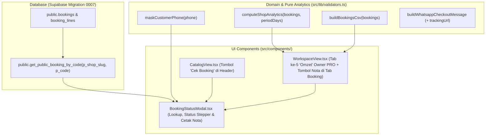

# Spesifikasi Desain: Sebaraja Fase 2 (P2 Monetisasi PRO — Cek Booking Publik, Cetak Nota & Tab Omzet)

**Tanggal:** 2026-11-22  
**Status:** Menunggu Persetujuan Spesifikasi  
**Lingkup:** Fase 2 (P2 Monetisasi PRO)

---

## 1. Tujuan & Nilai Bisnis

Menghadirkan fitur bernilai tinggi yang meningkatkan kepercayaan pelanggan (penyewa) sekaligus memberikan alasan kuat bagi pemilik usaha rental untuk berlangganan **Paket Bisnis PRO (Rp 23.000/bln)**:

1. **Modal Cek Status Booking Publik (`/[slug]?booking=SBR-XXXX`) & Cetak Nota Sewa**:
   - Pelanggan dapat mengecek status pesanan secara mandiri menggunakan kode booking (`SBR-YYMMDD-XXXX`) melalui tombol **"Cek Booking"** di header katalog atau langsung dari tautan deep-link di pesan WhatsApp checkout.
   - Baik Pelanggan maupun Admin/Owner dapat mencetak atau menyimpan **Nota / Tiket Booking Resmi** (PDF/Thermal-friendly via dialog cetak).
2. **Keamanan Privasi (PII Masking) via RPC `get_public_booking_by_code`**:
   - Tabel `bookings` tetap tertutup dari query `SELECT` publik (`anon`) agar daftar penyewa toko tidak bisa di-scrape.
   - Pencarian kode booking oleh pelanggan publik menggunakan RPC `public.get_public_booking_by_code(p_shop_slug, p_booking_code)` yang memvalidasi kecocokan eksak `shop_slug` + `code` serta menyamarkan nomor WhatsApp penyewa (contoh: `62812****890`).
3. **Tab Ke-5 Baru di Panel Kerja: `Omzet` (`WorkspaceTab = 'analytics'`) Khusus Owner PRO**:
   - Hanya dapat diakses oleh role **Owner** (Staf Gudang diblokir dengan notifikasi izin).
   - Untuk toko paket **Starter (FREE)**, menampilkan halaman teaser fitur **Bisnis PRO** dengan tombol upgrade instan.
   - Untuk toko **Bisnis PRO**, menampilkan:
     - Filter periode waktu: **Semua Waktu**, **30 Hari Terakhir**, **7 Hari Terakhir**.
     - **4 Kartu KPI Utama**: Total Omzet Terealisasi (`confirmed` + `picked_up` + `returned`), Potensi Menunggu DP (`pending`), Total Booking Aktif/Selesai & Rasio Konversi (%), serta Rata-rata Nilai Sewa (AOV).
     - **Peringkat Alat Paling Laris (Top Performing Units)**: Daftar unit dengan jumlah unit tersewa dan kontribusi rupiah tertinggi.
     - **Unduh Laporan CSV 1-Klik**: Ekspor riwayat booking ke file `.csv` untuk pembukuan Excel/Spreadsheet.

---

## 2. Evaluasi Pendekatan Teknis

| Pendekatan | Deskripsi | Kelebihan | Kekurangan | Keputusan |
| :--- | :--- | :--- | :--- | :--- |
| **A. RPC `get_public_booking_by_code` (PII Masked) + Kalkulasi Analitik Deterministik & Ekspor CSV (Recommended)** | Membuat RPC `SECURITY DEFINER` khusus pencarian 1 kode booking dengan penyamaran nomor telepon untuk publik, komponen `BookingStatusModal.tsx` terpadu (mode pencarian + nota siap cetak), serta fungsi kalkulasi analitik murni di `src/lib/validators.ts` untuk Tab ke-5 `Omzet`. | Aman dari kebocoran data pelanggan (tidak membuka RLS `SELECT` tabel `bookings` ke anon), 100% kompatibel dengan mode Cloud maupun Demo/Offline, dan mudah diuji dengan unit test. | Membutuhkan migrasi SQL `0007_phase2_pro_monetization.sql`. | **Dipilih** |
| **B. Membuka RLS `SELECT` Tabel `bookings` ke `anon`** | Mengizinkan klien publik melakukan query `.from('bookings').select('*').eq('code', code)`. | Tanpa RPC tambahan. | **Berbahaya:** Siapa pun dengan anon key dapat memanggil `.from('bookings').select('*')` tanpa filter dan mencuri seluruh nama & nomor HP pelanggan semua toko. | Ditolak (Risiko Keamanan PII) |

---

## 3. Arsitektur & Alur Data

---

## 4. Spesifikasi Detail

### 4.1. Migrasi Database `0007_phase2_pro_monetization.sql`
Fungsi `public.get_public_booking_by_code(p_shop_slug TEXT, p_booking_code TEXT)` mengembalikan JSONB berisi data booking beserta array `booking_lines` jika `lower(trim(code)) = lower(trim(p_booking_code))` dan `shop_slug = p_shop_slug`. Nomor telepon `customer_phone` disamarkan di sisi server menjadi format `6281****89` agar PII pelanggan tetap terlindungi.

### 4.2. Utilitas Domain & Analitik di [src/lib/validators.ts](file:///e:/Project/sebaralat/src/lib/validators.ts)
1. `maskCustomerPhone(phone: string): string`:
   - Menyamarkan bagian tengah nomor telepon (misal `6281234567890` -> `62812****890`).
2. `computeShopAnalytics(bookings: Booking[], periodDays?: number | null, nowMs?: number)`:
   - Memfilter booking berdasarkan `periodDays` (`null` = semua waktu, `30` = 30 hari terakhir, `7` = 7 hari terakhir).
   - Menghitung:
     - `realizedRevenue`: Total `totalAmount` dari booking berstatus `confirmed`, `picked_up`, atau `returned`.
     - `pendingRevenue`: Total `totalAmount` dari booking berstatus `pending`.
     - `totalBookings`: Jumlah seluruh booking pada periode tersebut.
     - `activeOrCompletedCount`: Jumlah booking `confirmed` + `picked_up` + `returned`.
     - `cancelledCount`: Jumlah booking `cancelled`.
     - `conversionRate`: Persentase `activeOrCompletedCount` terhadap total booking non-batal/keseluruhan.
     - `averageOrderValue`: Rata-rata nilai transaksi (`realizedRevenue / activeOrCompletedCount` atau `0`).
     - `topItems`: Peringkat unit dari `booking.lines` (untuk booking `confirmed`, `picked_up`, `returned`) berdasarkan total ` revenue` dan `qty` tertinggi.
3. `buildBookingsCsv(bookings: Booking[]): string`:
   - Menghasilkan string CSV dengan header `Kode Booking,Tanggal Buat,Nama Penyewa,No WhatsApp,Tanggal Mulai,Tanggal Selesai,Durasi (Hari),Status,Total (Rp),Rincian Unit,Catatan` dan escaping tanda kutip yang aman.
4. Pembaruan `buildWhatsappCheckoutMessage`:
   - Menyertakan baris tautan pelacakan status booking (`🔗 *Cek Status Booking:* ${trackingUrl}`) apabila `trackingUrl` tersedia.

### 4.3. Komponen `src/components/BookingStatusModal.tsx`
- Mendukung 2 cara buka:
  1. **Dari Pelanggan** (klik tombol **"Cek Booking"** di header [CatalogView.tsx](file:///e:/Project/sebaralat/src/components/CatalogView.tsx) atau parameter URL `?booking=SBR-...`): Menampilkan input pencarian kode booking (`SBR-YYMMDD-XXXX`) dan langsung menampilkan detail tiket/nota jika kode ditemukan.
  2. **Dari Admin/Owner** (klik tombol **"Nota / Detail"** pada kartu pesanan di tab Booking [WorkspaceView.tsx](file:///e:/Project/sebaralat/src/components/WorkspaceView.tsx)): Langsung menampilkan nota lengkap untuk dicetak.
- Menampilkan **Visual Status Timeline (4 Tahap)**:
  - `⏳ Menunggu Konfirmasi / DP` -> `✅ Stok Dikunci (Confirmed)` -> `📦 Unit Sedang Disewa` -> `🏁 Selesai Dikembalikan` (atau badge merah jika `❌ Dibatalkan`).
- Dilengkapi tombol:
  - **Cetak / Simpan Nota (PDF)** (`window.print()`)
  - **Salin Link Tiket Booking** (`/[slug]?booking=SBR-...`)
  - **Hubungi Admin via WA** (khusus tampilan pelanggan)

### 4.4. Tab Ke-5 `Omzet` (`analytics`) di [WorkspaceView.tsx](file:///e:/Project/sebaralat/src/components/WorkspaceView.tsx)
- Navigasi sub-tab di [WorkspaceView.tsx](file:///e:/Project/sebaralat/src/components/WorkspaceView.tsx#L252) diperbarui dari `grid-cols-4` menjadi `grid-cols-5`:
  1. `Stok`
  2. `Booking`
  3. `Omzet` *(Baru — Khusus Owner PRO)*
  4. `Log`
  5. `Profil`
- Jika `currentRole !== 'owner'`, mengeklik tab `Omzet` menampilkan toast: *"Terbatas: Laporan Omzet hanya untuk Owner."*
- Jika `!isPro`, menampilkan kartu paywall **Fitur Bisnis PRO** (konsisten dengan tab `Log` dan `LandingPage` pricing) beserta tombol upgrade PRO.
- Jika `isPro`, menampilkan filter periode (`Semua`, `30 Hari`, `7 Hari`), tombol **Unduh CSV**, 4 Bento KPI Cards, dan daftar **Top Unit Paling Menghasilkan**.
