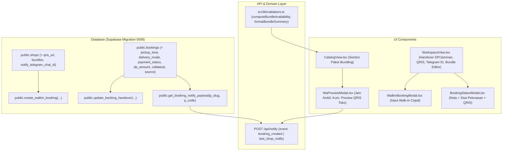

# Spesifikasi Desain: Sebaraja Fase 3 (Lead Alert, Serah Terima/DP, Walk-in Rental, QRIS & Paket Bundling)

**Tanggal:** 2026-11-22  
**Status:** Menunggu Persetujuan Spesifikasi  
**Lingkup:** Fase 3 (Seluruh 4 Opsi Operasional & Konversi Lanjutan)

---

## 1. Tujuan & Ringkasan 4 Modul

Fase 3 menyatukan alur pemesanan online, operasional tatap muka (*walk-in*), pembayaran DP via QRIS, serta pencegahan *lost-lead* menjadi satu sistem terintegrasi:

1. **Notifikasi Order Masuk Real-Time ke Owner (`notify_telegram_chat_id`)**:
   - Owner dapat memasukkan **Telegram Chat ID** toko di Tab Profil dan mengujinya dengan tombol **"Tes Kirim Notifikasi"**.
   - Setiap kali pelanggan membuat booking baru (`create_booking`), endpoint `/api/notify` otomatis mengirimkan ringkasan pesanan (Kode Booking, Nama, Link WA Penyewa, Jadwal, dan Rincian Unit) ke Telegram Owner agar tidak ada prospek yang terlewat meskipun pelanggan batal menekan *Send* di WhatsApp.
2. **Alur Checkout & Serah Terima Lengkap (Jam Ambil, Kurir, DP & Jaminan)**:
   - Di [WaPreviewModal.tsx](file:///e:/Project/sebaralat/src/components/WaPreviewModal.tsx), pelanggan memilih **Jam Rencana Ambil** (`08:00`–`21:00`) dan **Metode Pengambilan** (`Ambil di Toko` vs `Diantar Kurir`).
   - Di Tab **Booking** [WorkspaceView.tsx](file:///e:/Project/sebaralat/src/components/WorkspaceView.tsx), Admin/Owner dapat mencatat **Status Pembayaran** (`Belum Bayar`, `DP`, `Lunas`), **Nominal DP**, dan **Jaminan Ditahan** (`E-KTP Asli`, `SIM C`, `Deposit`, dll.).
   - Nota pada [BookingStatusModal.tsx](file:///e:/Project/sebaralat/src/components/BookingStatusModal.tsx) menampilkan status DP, sisa pelunasan, jam ambil, dan jaminan.
3. **Tombol "+ Catat Sewa Walk-in" (`WalkInBookingModal.tsx`)**:
   - Staf Gudang & Owner dapat mencatat penyewa yang datang langsung ke toko (*walk-in*) dalam hitungan detik.
   - Langsung membuat booking berstatus `picked_up` (`source = 'walkin'`), memotong stok pada tanggal terkait, masuk ke laporan **Omzet**, dan langsung siap cetak nota.
4. **Upload QRIS Toko (`qris_url`) & Paket Bundling Terhubung ke Stok Fisik (`bundles JSONB`)**:
   - Owner dapat mengunggah gambar **QRIS Toko** di Tab Profil agar otomatis tampil pada modal checkout & nota booking.
   - Owner dapat membuat **Paket Bundling** (misal *Paket Camping Berdua = 1 Tenda + 1 Kompor*) dengan harga paket per hari. Ketersediaan stok paket dihitung otomatis dari sisa stok fisik unit penyusunnya (`min(floor(avail(item) / qty))`), dan saat dibooking otomatis memotong kuota unit penyusunnya di server.

---

## 2. Arsitektur Database (Migrasi `0008_phase3_operations_bundles.sql`)



### 2.1. Keamanan & Privasi
- Kolom `notify_telegram_chat_id` **tidak** diekspos ke view publik `shops_public` maupun query publik katalog; hanya dibaca oleh Owner di workspace dan oleh server endpoint `/api/notify`.
- Penambahan `bundles` pada `create_booking` divalidasi di sisi server (membaca harga dan komposisi `itemLines` dari `shops.bundles` di database sehingga harga paket tidak dapat dimanipulasi dari klien).

---

## 3. Model Data Baru (`src/types/index.ts`)

```ts
export type DeliveryMode = 'pickup' | 'delivery';
export type PaymentStatus = 'unpaid' | 'dp' | 'paid';
export type BookingSource = 'catalog' | 'walkin';

export interface BundleLine {
  itemId: string;
  qty: number;
}

export interface RentalBundle {
  id: string;
  name: string;
  description: string;
  pricePerDay: number;
  lines: BundleLine[];
}
```

Perluasan pada `Shop`:
- `qrisUrl?: string;`
- `notifyTelegramChatId?: string;`
- `bundles?: RentalBundle[];`

Perluasan pada `Booking`:
- `pickupTime?: string;`
- `deliveryMode?: DeliveryMode;`
- `paymentStatus?: PaymentStatus;`
- `dpAmount?: number;`
- `collateral?: string;`
- `source?: BookingSource;`

---

## 4. Rencana Pengujian
- Unit tests di `src/lib/__tests__/validators.test.ts` untuk `computeBundleAvailability`, `calculateCartSummary` dengan bundle, `buildWhatsappCheckoutMessage` (jam ambil & kurir), dan skema Zod `RentalBundleSchema` / `BookingHandoverSchema`.
- Verifikasi Telegram formatter untuk `booking_created` di `src/lib/__tests__/telegram.test.ts`.
- Verifikasi penuh `npm test`, `npm run lint`, dan `npm run build`.
